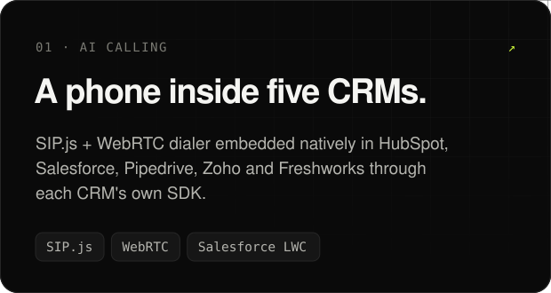
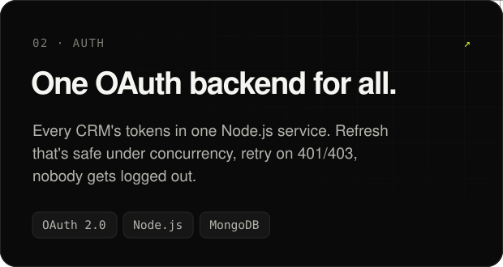
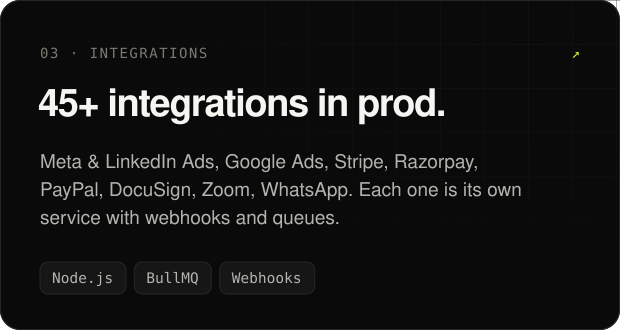
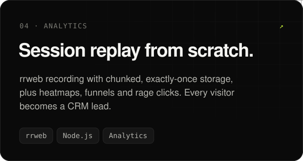
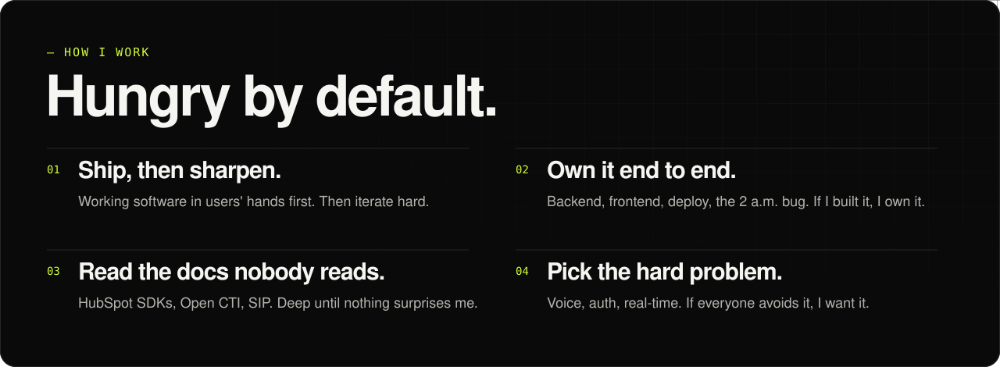

  
  
  
  

 

This code runs in production and belongs to my employer, so it's private. The full write-up is at <a href="https://amanjhacodes55.github.io">amanjhacodes55.github.io</a>.

  

  

  

<code>SIP.js</code> · <code>WebRTC</code> · <code>OAuth 2.0</code> · <code>BullMQ</code> · <code>WebSockets</code> · <code>Salesforce LWC + Apex</code> · <code>rrweb</code>

 

| Open source | |
|---|---|
|  [**codecrack**](https://github.com/amanjhacodes55/codecrack) · [**live demo ↗**](https://codecrack-6okk.onrender.com) | A HackerRank-style coding judge: Docker-sandboxed code execution, a step-through debugger, 71 verified problems, mock tests and discussions (Next.js, MongoDB, Python) |
| [**orbitcrm**](https://github.com/amanjhacodes55/orbitcrm) · [**live demo ↗**](https://orbitcrm-6cm4.onrender.com) | An open-source, monday-style CRM: boards (table/kanban/calendar), automations and webhooks, an omnichannel inbox, a dialer and an app marketplace (Next.js, TypeScript, MongoDB) |
| [**devpulse-ai**](https://github.com/amanjhacodes55/devpulse-ai) | A GitHub bot that reviews PRs and runs OWASP Top 10 security checks |
| [**pulse-engine**](https://github.com/amanjhacodes55/pulse-engine) | A high-throughput webhook delivery engine with retries |
| [**amanjhacodes55.github.io**](https://github.com/amanjhacodes55/amanjhacodes55.github.io) | My portfolio, with a terminal you can type in. Try `sudo hire aman` |

 

