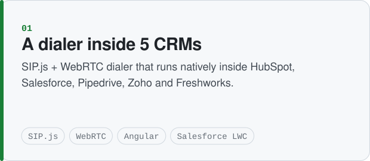
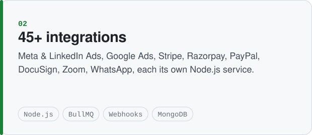
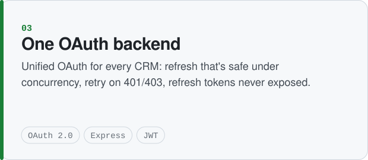
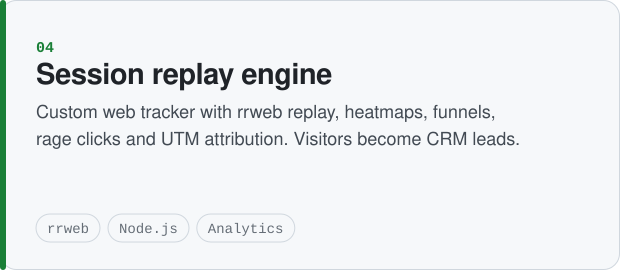

<picture>
  <source media="(prefers-color-scheme: dark)" srcset="assets/hero-dark.svg">
  
</picture>

  
  
  
  

<picture>
  <source media="(prefers-color-scheme: dark)" srcset="assets/heatmap-dark.svg">
  
</picture>

## What I've built

<picture><source media="(prefers-color-scheme: dark)" srcset="assets/card1-dark.svg"></picture>
<picture><source media="(prefers-color-scheme: dark)" srcset="assets/card2-dark.svg"></picture>
<picture><source media="(prefers-color-scheme: dark)" srcset="assets/card3-dark.svg"></picture>
<picture><source media="(prefers-color-scheme: dark)" srcset="assets/card4-dark.svg"></picture>

> The production code is private because it belongs to my employer. The full write-up is on **[amanjha7.github.io](https://amanjha7.github.io)**.

## Stack

  

`SIP.js` · `WebRTC` · `OAuth 2.0` · `BullMQ` · `WebSockets` · `Salesforce LWC + Apex` · `HubSpot / Pipedrive / Zoho SDKs` · `rrweb`

## Open source

| Project | What it does |
|---|---|
| [**devpulse-ai**](https://github.com/amanjha7/devpulse-ai) | A GitHub bot that reviews PRs and runs OWASP Top 10 security checks |
| [**pulse-engine**](https://github.com/amanjha7/pulse-engine) | A high-throughput webhook delivery engine with retries |
| [**amanjha7.github.io**](https://github.com/amanjha7/amanjha7.github.io) | My portfolio, plain HTML deployed with GitHub Actions |
